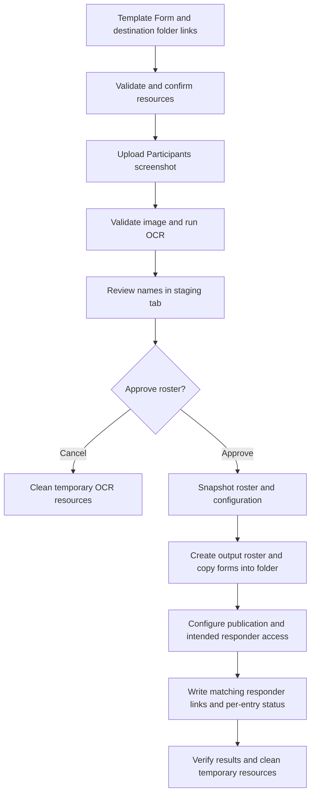

# Workflow Design

Issue: [#8](https://github.com/Michael-Kowata/ITC-492/issues/8).
Status: proposed design; runtime behavior must be validated in M2.

## Intended Users and Guided Interface

The tool supports multiple non-technical instructors, each using an independent
copy of a reusable control spreadsheet. This is not a shared concurrent dashboard.
Routine users do not edit Code.gs, paste internal IDs, or configure developer tools.
Deployment and source synchronization remain maintainer responsibilities.

| Step | User action | Required feedback |
| --- | --- | --- |
| Setup | Enter template Form and folder links; complete first-use authorization | Show resolved names, actionable access errors, and saved settings |
| Upload | Select a screenshot | Show filename, validation errors, and processing status |
| Review | Correct the staging roster and remove non-students | Show approved count; let users return to review before generation |
| Generate | Confirm creation explicitly | Show processed/total count and per-entry status; prevent duplicate submissions |
| Finish | Open the output roster or retry failed entries | Show result link, partial failures, and a recovery action |

Use descriptive labels, logical keyboard focus, and status text rather than color
alone. Keep errors specific to the action the instructor can take, such as checking
folder access; keep sensitive technical details out of ordinary error messages.
Saved settings remain editable and are revalidated before a new run. Setup guidance
must cover copying the control spreadsheet and granting required permissions.

Configuration and run state must be scoped to each control spreadsheet and its
operator. Copying the distribution template must not carry prior names, output
links, credentials, or run state. M2 must verify the chosen storage and copying
behavior with two independent copies. An instructor can intentionally select a
shared destination folder, but one copy must not resume or change another's run.

M2 will review a lightweight interface walkthrough and validate first-use setup;
later implementation must undergo the usability evaluation specified in R15.
The sidebar upload/OCR path is implemented and owner-tested. Guided roster
review and approval are implemented and owner-tested; generation and
representative-instructor usability testing remain pending.

The owner confirmed the original review flow works. The subsequent multi-image
extension awaits live validation: successive OCR results append without replacing
corrections and filename/upload IDs track sources. Up to three selected images
are processed sequentially behind one action; failed images can be retried alone.
Exact full-name/attendance matches across known sources are skipped before
append, with a per-image count instead of repeated warnings. Distinct same-name
students must be added manually if skipped. Same-image duplicates, uncertain
matches, and attendance conflicts require manual review. Repeated appends of a retained upload
ID are ignored; re-extraction still requires review. Approval is invalidated by
additions. Capacity is 300 staging rows; approval entries use chunked properties.

The review prototype uses a dedicated control-sheet tab and document properties
for its active sheet ID and approved snapshot. IDs survive name corrections;
new rows receive IDs on refresh. Approval uses a fingerprint of the staging rows
and refuses stale previews. Edits invalidate approval, and future generation must
revalidate it. Cancel clears state but retains evidence tabs. This is not yet
persistent Form-generation run state or a validated copy-isolation mechanism.

## Template and Folder Configuration

The operator supplies two links in the control spreadsheet's sidebar:

1. **Template Form:** the owner/editor link identifying the form to copy, not
   a student's responder link. Display its resolved title for confirmation.
2. **Destination Drive folder:** where the student form copies will be stored.
   Display its resolved name for confirmation.

Validate link format, resource type, template access/copy permission, and ability
to create files in the destination. A syntactically valid URL alone is insufficient.
Report failures before processing the screenshot or generating outputs. Treat
links as resource identifiers, not instructions to fetch arbitrary URLs.
Recheck permissions when generating outputs because access may change.

Proposed default: create the output roster spreadsheet in the same destination
folder. The control spreadsheet stays separate. Snapshot resolved resource IDs
for each approved run so changing sidebar settings cannot redirect a retry.

## Data Flow

The staging tab supports corrections, additions, and removal of non-students.
Exclude UI controls and role labels, but do not infer hidden participants or
student identity. Two equal names remain two separate entries. Freeze the
approved roster for the run; later edits require explicit reconciliation or a
new run rather than silently changing completed outputs.

## Run and Entry Records

### Attendance Priority

Review excludes the identified IT Support and Instructor entries and preserves
the attendance suffix `- IP`. Host/co-host labels alone do not establish that
someone is staff. Store attendance mode and original row position with the
stable entry ID. Under the current convention, `- IP` means in-person and its
absence means online; the operator can correct this before approval.

Snapshot the approved order with in-person students first and original order
within each group. Use that order for generation and roster display; preserve
the suffix in roster names, but strip it from copied Form titles and filenames.
Retries retain the approved order and IDs.
The operator distributes in-person links first. This priority does not itself
restrict access to online Forms or implement scheduled release.

| Record | Minimum fields | Purpose |
| --- | --- | --- |
| Run | run ID, template ID, folder ID, approval time, access policy, output spreadsheet ID, status | Resume the same operation with stable configuration |
| Entry | entry ID, run ID, approved name, form ID, responder URL, status, last error | Match the right form to each student without using names as keys |
| Temporary resource | run ID, resource ID, purpose, cleanup status | Remove only temporary files owned by this run |

Proposed entry states: `pending`, `copied`, `access_pending`, `linked`, `verified`,
and `failed` with the last successful stage retained. A copied form is not yet
proof that students can respond. Mark a run complete only when all entries are
verified; otherwise show partial completion and actionable errors.

## Student Access and Publication

Naming follows `Student Name - Template Form Title`, removing only the student's
trailing `- IP`. Set both the Form title and Drive filename; do not change the
template or reviewed attendance. Capture the template title in generation
configuration. Duplicate titles are allowed; recovery uses stable entry/Form IDs.
Form creation is not implemented yet.

Each copy preserves the template questions and includes the student's name in
its title. Its own responder link is written beside the approved name. Keep form
IDs/edit links in operator records, not in the student-facing link column.

Publication, accepting responses, and responder permissions must be validated
for the selected Google account and intended audience in #9. The audience is
non-traditional learners taking an OSHA certification course. Require Google
sign-in while allowing personal accounts without a school-domain restriction.
Never silently widen access when the selected policy fails. The roster and
destination folder are not automatically made public: responder access does
not require granting students editing access to the forms or folder.
Link distribution remains through the operator's existing class workflow;
email automation is outside scope. Verify access using an intended respondent,
not only the owner/editor account. Test an external personal account and verify
signed-out users must sign in. Report account/template restrictions that prevent
this policy. No access test has yet been performed.

## Recovery and Data Handling

Persist each created resource ID before advancing to the next stage. Reconcile
ambiguous outcomes (creation succeeded but recording failed) using a stable
run/entry marker before retrying; the supported mechanism is an M2 trial decision.
Prevent concurrent generation for the same run. Restarting a failed write must
reuse the existing form rather than create another copy.

Cleanup applies only to tracked temporary OCR resources, never the source
template, destination folder, or completed outputs. Cancellation before approval
creates no output roster or forms. Once generation starts, preserve completed
outputs and report partial status rather than silently deleting them.

M2 must choose persistent storage, locking/reconciliation, OCR, upload limits,
and temporary-file retention/cleanup behavior. Use fictional names for trials.
These are design requirements, not claims of implemented protections.
