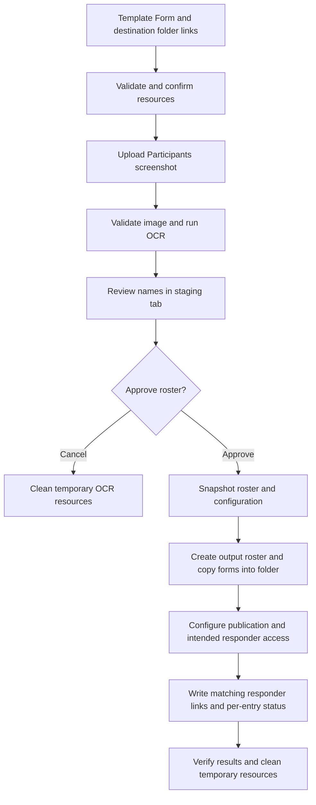

# Workflow Design

Issue: [#8](https://github.com/Michael-Kowata/ITC-492/issues/8).
Status: proposed design; runtime behavior must be validated in M2.

## Configuration Before Upload

The operator supplies two links in the control spreadsheet's sidebar:

1. **Template Form:** the owner/editor link identifying the form to copy, not
   a student's responder link. Display its resolved title for confirmation.
2. **Destination Drive folder:** where the student form copies will be stored.
   Display its resolved name for confirmation.

Validate link format, resource type, template access/copy permission, and ability
to create files in the destination. A syntactically valid URL alone is insufficient.
Report failures before processing the screenshot or generating outputs. Treat
links as resource identifiers, not instructions to fetch arbitrary URLs.
Recheck permissions when generating outputs because access may change.

Proposed default: create the output roster spreadsheet in the same destination
folder. The control spreadsheet stays separate. Snapshot resolved resource IDs
for each approved run so changing sidebar settings cannot redirect a retry.

## Data Flow

The staging tab supports corrections, additions, and removal of non-students.
Exclude UI controls and role labels, but do not infer hidden participants or
student identity. Two equal names remain two separate entries. Freeze the
approved roster for the run; later edits require explicit reconciliation or a
new run rather than silently changing completed outputs.

## Run and Entry Records

| Record | Minimum fields | Purpose |
| --- | --- | --- |
| Run | run ID, template ID, folder ID, approval time, access policy, output spreadsheet ID, status | Resume the same operation with stable configuration |
| Entry | entry ID, run ID, approved name, form ID, responder URL, status, last error | Match the right form to each student without using names as keys |
| Temporary resource | run ID, resource ID, purpose, cleanup status | Remove only temporary files owned by this run |

Proposed entry states: `pending`, `copied`, `access_pending`, `linked`, `verified`,
and `failed` with the last successful stage retained. A copied form is not yet
proof that students can respond. Mark a run complete only when all entries are
verified; otherwise show partial completion and actionable errors.

## Student Access and Publication

Each copy preserves the template questions and includes the student's name in
its title. Its own responder link is written beside the approved name. Keep form
IDs/edit links in operator records, not in the student-facing link column.

Publication, accepting responses, and responder permissions must be validated
for the selected Google account and intended audience in #9. The audience is
non-traditional learners taking an OSHA certification course. Require Google
sign-in while allowing personal accounts without a school-domain restriction.
Never silently widen access when the selected policy fails. The roster and
destination folder are not automatically made public: responder access does
not require granting students editing access to the forms or folder.
Link distribution remains through the operator's existing class workflow;
email automation is outside scope. Verify access using an intended respondent,
not only the owner/editor account. Test an external personal account and verify
signed-out users must sign in. Report account/template restrictions that prevent
this policy. No access test has yet been performed.

## Recovery and Data Handling

Persist each created resource ID before advancing to the next stage. Reconcile
ambiguous outcomes (creation succeeded but recording failed) using a stable
run/entry marker before retrying; the supported mechanism is an M2 trial decision.
Prevent concurrent generation for the same run. Restarting a failed write must
reuse the existing form rather than create another copy.

Cleanup applies only to tracked temporary OCR resources, never the source
template, destination folder, or completed outputs. Cancellation before approval
creates no output roster or forms. Once generation starts, preserve completed
outputs and report partial status rather than silently deleting them.

M2 must choose persistent storage, locking/reconciliation, OCR, upload limits,
and temporary-file retention/cleanup behavior. Use fictional names for trials.
These are design requirements, not claims of implemented protections.
